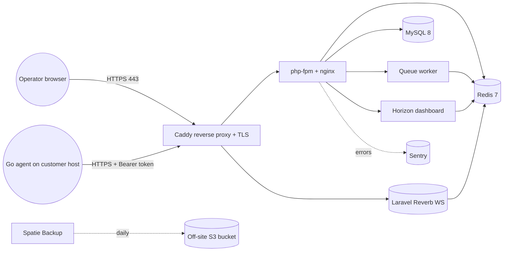
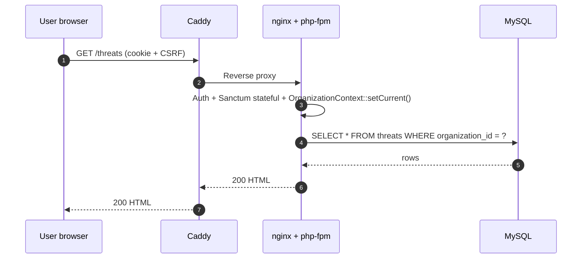
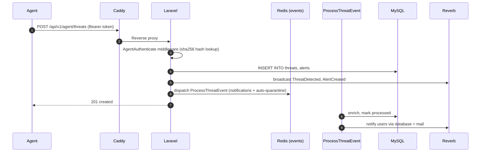
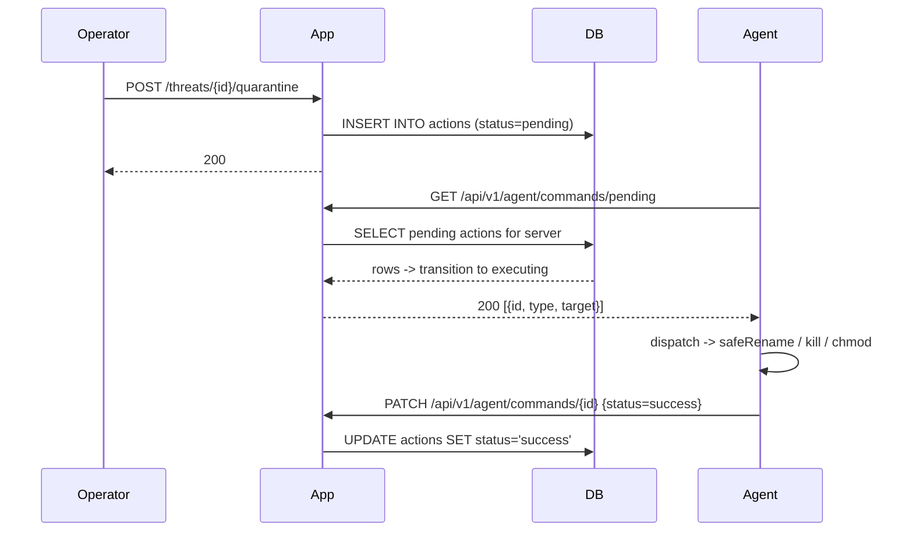

# Architecture

## Components



## Data model (excerpt)

```
organizations 1───* users
              1───* projects 1───* servers 1───* agents
                                  └───* threats 1───* threat_logs
                                                 └───* actions (agent commands)
                                                 └───* alerts
              1───* notification_settings
```

Every domain model that lives under an `organizations` row carries a global
[`OrganizationScope`](../app/Models/Scopes/OrganizationScope.php). Queries made
by an authenticated dashboard user are silently filtered to their organization.
Agent and queue contexts opt out by calling
`App\Support\OrganizationContext::asSystem()`.

## Request flow

### Dashboard read



### Agent threat ingestion



### Command channel (operator → agent)



## Background pipeline

| Queue          | Purpose                                                       |
|----------------|---------------------------------------------------------------|
| `events`       | `ProcessThreatEvent`, `ScanCompletedJob`                      |
| `notifications`| `ThreatDetectedNotification`, `ServerOfflineNotification`, `WeeklyDigestNotification` |
| `default`      | Sanctum prune, schedule fan-out                               |

Scheduled commands (registered in `routes/console.php`):

- `torex:heartbeat-sweep` -- every minute, flips stale servers to offline
- `torex:weekly-digest`   -- Monday 08:00, sends weekly digest
- `backup:run` / `backup:run --only-db` / `backup:clean` / `backup:monitor`
- `activitylog:clean` -- prune Spatie activity log
